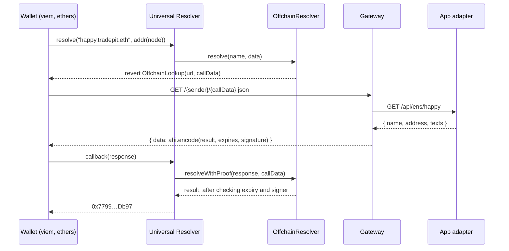

# Gateway

A CCIP-Read gateway that makes every app username resolve as `<username>.<parent>.eth` on Ethereum mainnet. The app stays the system of record. The gateway reads it through the app's read-only adapter and signs each answer, and the resolver contract in [`../contracts`](../contracts) checks the signature.

## What CCIP-Read is

CCIP-Read ([EIP-3668](https://eips.ethereum.org/EIPS/eip-3668)) lets a contract answer a read with "ask this server, then come back". The resolver reverts with an `OffchainLookup` error that carries a URL and the original call. The client fetches that URL and passes the response to a callback on the contract. The callback checks that a trusted key signed the response and returns the answer as if it had been stored onchain. Each user costs zero transactions, because the records never leave the app's database.

## Request flow



The diagram skips one hop: the Universal Resolver wraps the lookup in a batch gateway request. viem runs the batch gateway locally, so the wallet calls this gateway directly. Clients that don't may go through ENS's hosted batch gateway, which calls this gateway server-side.

## What it answers

The gateway answers only `<username>.<ENS_PARENT_NAME>`, where the username passes the app's rules: 3 to 20 characters of `a-z`, `0-9` and `-`, with no leading, trailing or double hyphen.

| Call | Answer |
| --- | --- |
| `addr(bytes32)` | The user's address |
| `addr(bytes32,uint256)` | The address for coin type 60 (ETH), empty for other coin types |
| `text(bytes32,string)` | The text record from the app, or `""` |
| `contenthash(bytes32)` | Empty |
| `multicall(bytes[])` | Up to 10 of the calls above, answered as `bytes[]` |

The parent name itself, nested names, invalid usernames and unknown usernames get a signed empty answer. Only valid usernames reach the app.

Errors are never signed. Malformed calldata, an unsupported function or a node that doesn't match the name gets HTTP 400. If the app is down, takes longer than 3 seconds or answers anything other than 200 or 404, the gateway returns 502 and the wallet sees a failed lookup instead of a wrong answer.

App answers, including "not found", are cached for 30 seconds.

## Setup

```sh
corepack pnpm install
cp gateway/.env.example gateway/.env
cast wallet new
```

Put the private key in `SIGNER_PRIVATE_KEY`. Keep the address: you pass it to the resolver when you deploy it.

> [!WARNING]
> The signer key is not the deployer or owner key. It lives on the gateway host and only signs answers. If it leaks, someone can forge records for your names until you remove it from the resolver with `setSigners`. Keep the owner key in a Foundry keystore, never on the gateway host.

| Variable | Required | Default | Description |
| --- | --- | --- | --- |
| `SIGNER_PRIVATE_KEY` | yes | | Key that signs answers. Its address goes into the resolver. |
| `ENS_PARENT_NAME` | yes | | The name you own, e.g. `tradepit.eth`. Must be normalized. |
| `APP_API_URL` | no | `http://localhost:3000` | Base URL of the app adapter. |
| `PORT` | no | `8080` | HTTP port. |
| `RESPONSE_TTL_SECONDS` | no | `300` | How long a signed answer stays valid. |

The gateway checks these at startup and lists every problem before it exits.

## Run

```sh
corepack pnpm --filter gateway dev
```

## Try it

With the app running at `APP_API_URL`, build the calldata the resolver would send for `addr(happy.tradepit.eth)`. The name is DNS-encoded: each label is prefixed by its length and the name ends with a zero byte.

```sh
NAME=happy.tradepit.eth
DNS_NAME=0x$(printf '\005happy\010tradepit\003eth\000' | od -An -tx1 | tr -d ' \n')
CALL=$(cast calldata "resolve(bytes,bytes)" $DNS_NAME $(cast calldata "addr(bytes32)" $(cast namehash $NAME)))
RESOLVER=0x5615deb798bb3e4dfa0139dfa1b3d433cc23b72f   # any address works locally

curl -s http://localhost:8080/$RESOLVER/$CALL.json
```

```json
{"data":"0x0000000000000000000000000000000000000000000000000000000000000060…"}
```

Decode the answer into `(result, expires, signature)`:

```sh
cast abi-decode "f()(bytes,uint64,bytes)" <data>
```

```text
0x000000000000000000000000779981590e7ccc0cfae8040ce7151324747cdb97
1793733759 [1.793e9]
0xf405b76842651144bf6ffb2f3c36fb977c91038f8ede38be3927ace5b4ebdf53…1b
```

The result is `abi.encode(address)`, exactly what `addr(bytes32)` returns onchain.

## Test

```sh
corepack pnpm --filter gateway test
corepack pnpm --filter gateway typecheck
```

## Deploy

Run the gateway on any host that serves HTTPS. Wallets call it from browsers, so it allows every origin.

```sh
docker build -f gateway/Dockerfile -t tradepit-gateway .
docker run --env-file gateway/.env -p 8080:8080 tradepit-gateway
```

Build from the repository root: the image installs from the workspace `pnpm-lock.yaml`. `GET /health` returns `{"ok":true}` for health checks.

The resolver's gateway URL is `https://<host>/{sender}/{data}.json`.
